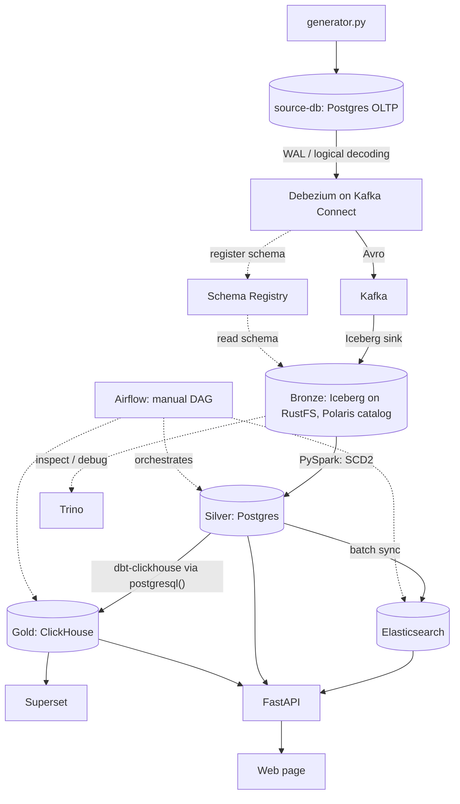

# Data platform — design

A learning project: build a complete, small data platform on Docker Compose and see every piece
work end to end — CDC from an OLTP source, an event log in a lakehouse, a history-keeping silver
layer, an OLAP gold layer for dashboards, and a search index for a web app.

**Scope: demo, not production.** It only has to run and be easy to follow. That means:

- Docker Compose only (no Kubernetes, no operators), on the native Docker Engine inside WSL
  (not Docker Desktop).
- The source is a Postgres database filled by one Python generator script.
- Airflow DAGs are triggered **manually** (`schedule=None`).
- No HA, read replicas, connection poolers, TLS or backups.
- Silver is **eventually consistent across tables** (see §6.2).

## 1. Architecture



Data lives in three places, each with one job: raw change events in **bronze** (the source of
truth — every later layer can be rebuilt from it), a history-keeping copy in **silver**, and
analytical models in **gold**. Elasticsearch is a search index derived from silver.

Each layer has one query tool, so the SQL engines don't overlap:

| Layer | Stored in | Queried with |
|---|---|---|
| Bronze | Iceberg on RustFS (Polaris) | **Trino** — inspection and debugging only |
| Silver | Postgres | Plain Postgres (`psql`, the API) |
| Gold | ClickHouse | **ClickHouse** — OLAP for Superset and the API |

Gold could live in Postgres at demo data sizes; ClickHouse is kept on purpose to learn a columnar
OLAP engine (MergeTree, background merges, `FINAL`, incremental loads from an external source).

## 2. Components

| Component | Role | Notes |
|---|---|---|
| `source-db` (Postgres 16) | Simulated OLTP: `users`, `orders`, `order_details` | Own instance (`compose/source.yml`), database `source-db`, host port 5433, `wal_level=logical` |
| `generator.py` | Continuous insert/update/delete into the source | Python + Faker + psycopg, adjustable rate |
| Kafka Connect | Runs Debezium (source) and the Iceberg sink | Custom image on `confluentinc/cp-kafka-connect` (AvroConverter built in) + Debezium Postgres plugin + Iceberg sink zip (not published as an artifact — built from the Iceberg source in a multi-stage Dockerfile; **Iceberg 1.10.2**, the newest that runs on the worker's Java 11) |
| Kafka UI | Look inside Kafka: topics, Avro-decoded messages, schemas, connectors (read-only) | `kafbat/kafka-ui`, host port 8082 |
| Kafka (+ Zookeeper) | Carries Avro events | Already in `compose/infra.yml` |
| Schema Registry | Stores Avro schemas, checks compatibility | Already in `compose/infra.yml` |
| RustFS (S3) + Iceberg | Bronze: append-only change events | Already in the stack (`rustfs/rustfs:1.0.4`, replaced MinIO) |
| Polaris | Iceberg REST catalog for bronze | Already in the stack (OAuth2, scope `PRINCIPAL_ROLE:ALL`) |
| Trino | SQL over bronze (inspection, debugging, test scenarios) | Already in the stack; not on the main data path |
| PySpark | Bronze → silver (SCD Type 2) | Existing Spark cluster, submitted via REST 6066; `spark.master` is set in `spark-defaults.conf` so REST jobs get real executors; driver/executor logs land in Grafana (`service=spark-job`) |
| Postgres (silver, Postgres 16) | Silver tables, also the web app's database | Database `data-platform` (`POSTGRES_DB`) on the existing `postgres` service, next to `airflow` and `polaris`; Airflow reaches it as `postgres_conn` |
| ClickHouse | Gold (OLAP): stores the gold tables, serves Superset and the API | Single node |
| dbt-clickhouse | Silver → gold | Runs in the Airflow containers (`./dbt`); added to `airflow/requirements.txt` in the gold phase — check it resolves against the Airflow 2.9.2 constraints |
| Superset | Dashboards | Custom image adding the `clickhouse-connect` driver (not in the stock image) |
| Elasticsearch 7.17 | Search for the web app | Already in `compose/infra.yml`; Python client must be `elasticsearch` 7.x (8.x refuses a 7.x server) |
| FastAPI | The web app's only read path | ES for search, silver for detail/history, gold for numbers |
| Airflow | Orchestrates the batch steps | Manual trigger only; runs light tasks itself (SQL on Postgres, the ES sync); heavy transforms run in Spark and dbt |
| Grafana + Loki + Alloy | Logs of every container (Docker json-file logs) and of Spark jobs | Already in the stack; every service starts only after Alloy is healthy, so no log line is missed |

All services share one bridge network, `lakehouse`, and reach each other by service name
(`kafka:29092`, `http://polaris:8181`, `postgres:5432`, …); host ports and the Airflow connections
are listed in [services.md](services.md).

## 3. Source

### 3.1. Schema

Three tables in schema `shop` of database `source-db` (DDL in `source/schema.sql`). The names are `users` and `orders`
because `user` and `order` are reserved words in PostgreSQL.

| Table | Primary key | Main columns |
|---|---|---|
| `shop.users` | `user_id` | `email` (unique), `full_name`, `phone`, `city`, `status` (active / locked / closed), `created_at`, `updated_at` |
| `shop.orders` | `order_id` | `user_id`, `status` (pending / paid / shipped / completed / cancelled / refunded), `payment_method` (cod / card / bank_transfer / e_wallet), `shipping_city`, `total_amount numeric(18,2)`, `currency char(3)` (default VND), `ordered_at`, `created_at`, `updated_at` |
| `shop.order_details` | `order_detail_id` | `order_id`, `line_number` (unique per order), `sku`, `product_name`, `category`, `quantity`, `unit_price`, `discount_amount`, `line_total` (all money `numeric(18,2)`), `created_at`, `updated_at` |

Primary keys are `bigint GENERATED ALWAYS AS IDENTITY`: the generator never supplies IDs.

Design choices:

- Status columns are `varchar` + `CHECK` instead of ENUM — easier to change, and handy for
  schema-evolution experiments.
- `line_total` (= `quantity × unit_price − discount_amount`) is a plain column computed by the
  generator. Generated columns are not sent by logical replication before PostgreSQL 18.
- `updated_at` is maintained by a trigger.
- `order_details.order_id` has `ON DELETE CASCADE`, so deleting an order produces deletes on two
  tables in one transaction.

### 3.2. CDC setup

- `wal_level = logical` (passed as `postgres -c wal_level=logical` in compose).
- `max_slot_wal_keep_size = 1GB`: caps how much WAL an unread slot may hold, so a stopped
  Debezium can't fill the laptop's disk. Past the cap Postgres invalidates the slot and Debezium
  has to re-snapshot — itself a test scenario (§10).
- `REPLICA IDENTITY FULL` on all three tables, so update/delete events carry the full old row.
- Publication `dbz_publication` with only the three tables, created by `source/schema.sql`
  (Debezium must not create it: its default would be `FOR ALL TABLES`, which needs superuser).
- A dedicated `debezium` user with `LOGIN` + `REPLICATION` and `SELECT` on `shop` (also on future
  tables, via `ALTER DEFAULT PRIVILEGES`); password `SOURCE_POSTGRES_DB_DEBEZIUM_PASSWORD`.
- Heartbeat table `public.debezium_heartbeat` (one row, `INSERT`/`UPDATE` granted to `debezium`),
  also in the publication — see `heartbeat.action.query` in §4.2.

All of it — schema, tables, triggers, CDC setup — lives in **`source/schema.sql`**, applied on
every `up` by the one-shot **`source-db-setup`** job (`compose/source.yml`, image `postgres:16`,
`psql -v ON_ERROR_STOP=1`). The script is idempotent (`IF NOT EXISTS`, `CREATE OR REPLACE
TRIGGER`, and `SELECT … WHERE NOT EXISTS … \gexec` for the publication and the role, which have
no `IF NOT EXISTS`). The Debezium password reaches SQL as a psql variable: compose passes
`.env` into the container, the job runs `psql -v debezium_password="$DEBEZIUM_PASSWORD"`, and the
script reads `:'debezium_password'` (quoted safely; psql does not substitute variables inside
`DO $$ … $$`, hence `\gexec`).

### 3.3. Generator

`generator.py` loops forever at a configurable rate (`--rate` events/second) and randomly:

- creates an order — in **one transaction**: insert `orders`, insert 1–5 `order_details`, then
  update `orders.total_amount`;
- moves an order's status forward (pending → paid → shipped → completed; or → cancelled;
  a completed order may become refunded);
- updates a user (city, phone) or locks a user;
- occasionally deletes an order (cascades to its lines).

It is a Compose service under a profile, started and stopped by hand
(`docker compose --profile generator up -d generator`), so the stack can run without new data.

Implementation (`source/generator.py`, image `custom-generator`): each tick picks a weighted
action — create order 45 %, advance order 30 %, update user 10 %, create user 8 %, delete order
4 %, lock/unlock user 3 % — at `GENERATOR_RATE` events/s; it first seeds 20 users. Names come from
Faker `vi_VN`; cities, products (17 SKUs in 7 categories) and phone numbers from fixed lists, so
the data stays clean. Two details that matter for CDC: the connection runs in **autocommit** mode,
so every action is its own committed transaction (without it, psycopg's implicit transaction
turns every action into a savepoint and nothing is committed until the generator stops); and it
handles `SIGTERM` (as PID 1 it would otherwise ignore it), so `docker compose stop` ends cleanly
after the current action. How to run it — in a container or directly with Python — is in
[services.md](services.md#running-the-generator).

## 4. Events: Avro + Schema Registry

### 4.1. Why Avro

By default Debezium emits JSON with the full schema inside every message: large messages and
nothing stops a schema change from breaking consumers. With Avro, a message is compact binary
plus a 5-byte prefix (magic byte + schema ID); the schema itself is stored once in the registry.
The registry also checks every new schema against the previous one, so an incompatible change is
rejected at the start of the pipeline instead of silently corrupting data downstream.

Subjects use `TopicNameStrategy` (topic `src.shop.orders` → subjects `src.shop.orders-key` and
`src.shop.orders-value`), compatibility `BACKWARD`.

### 4.2. Debezium connector

```json
{
  "connector.class": "io.debezium.connector.postgresql.PostgresConnector",
  "tasks.max": "1",
  "database.hostname": "source-db",
  "database.port": "5432",
  "database.dbname": "${env:SOURCE_POSTGRES_DB}",
  "database.user": "debezium",
  "database.password": "${env:SOURCE_POSTGRES_DB_DEBEZIUM_PASSWORD}",
  "plugin.name": "pgoutput",
  "publication.name": "dbz_publication",
  "publication.autocreate.mode": "disabled",
  "slot.name": "dbz_slot",
  "topic.prefix": "src",
  "table.include.list": "shop.users,shop.orders,shop.order_details",
  "tombstones.on.delete": "false",
  "decimal.handling.mode": "precise",
  "heartbeat.interval.ms": "10000",
  "heartbeat.action.query": "INSERT INTO public.debezium_heartbeat (id, ts) VALUES (1, now()) ON CONFLICT (id) DO UPDATE SET ts = EXCLUDED.ts",
  "key.converter": "io.confluent.connect.avro.AvroConverter",
  "key.converter.schema.registry.url": "http://schema-registry:8081",
  "value.converter": "io.confluent.connect.avro.AvroConverter",
  "value.converter.schema.registry.url": "http://schema-registry:8081"
}
```

- `${env:...}`: secrets come from the Connect container's environment (filled from `.env`) via
  Kafka's `EnvVarConfigProvider` (worker config `config.providers=env`), so no password is
  stored in the connector JSON.
- `publication.autocreate.mode=disabled`: use the publication from §3.2, fail loudly if missing.
- `tombstones.on.delete=false`: after a delete Debezium would otherwise send an extra message
  with a `null` value, used only for Kafka log compaction, which this project does not use.
- `decimal.handling.mode=precise`: never `double` for money.
- `heartbeat.interval.ms` + `heartbeat.action.query`: pgoutput skips transactions that touch no
  published table, so while `shop.*` is idle Debezium never sees a newer LSN, cannot confirm it,
  and the slot keeps all WAL written meanwhile (measured: lag stuck at ~2.7 MB). A heartbeat alone
  only re-sends the old offset; the action query upserts the row of `public.debezium_heartbeat`
  every 10 s, a change that flows through the slot so the LSN advances (lag back under 1 KB). The
  table is in the publication but not in `table.include.list`, so it gets no Kafka topic; the
  heartbeats themselves go to topic `__debezium-heartbeat.src`.
- `timestamptz` always maps to `ZonedTimestamp` strings; `time.precision.mode` only affects
  `timestamp`/`time` without zone, which the schema doesn't use, so it keeps its default.
- On first start Debezium snapshots the existing rows (events with `op = r`), then streams the WAL.
- Debezium **2.7.4.Final**: the base image `cp-kafka-connect:7.6.0` runs Java 11, and Debezium
  3.x needs Java 17. The plugin tarball comes from Maven Central, checksum-verified, in
  `connect/Dockerfile`.
- The generator writes an order as INSERT + UPDATE (`total_amount` is set after the lines) in one
  transaction, so a new order yields a `c` and a `u` with the same `txId` — the reason silver keeps
  only the last event per key per transaction (§6.2).

Connectors are registered by the one-shot `connect-setup` job through the Kafka Connect REST API
(same pattern as the other `*-setup` jobs: idempotent, check every HTTP code): every
`connect/connectors/<name>.json` is `PUT` to `/connectors/<name>/config` (creates or updates), then
the job waits until the connector and its task are `RUNNING`.

### 4.3. Type mapping

| Postgres | Avro (via Debezium) | Note when reading in Spark |
|---|---|---|
| `bigint` | `long` | |
| `integer`, `smallint` | `int` | Avro has no short |
| `varchar`, `text` | `string` | |
| `numeric(18,2)` | `bytes` + logical type `decimal` | Exact, thanks to `precise` mode; in bronze it becomes `decimal(38,2)` (the sink keeps the scale but not the precision) |
| `timestamptz` | `string` (`io.debezium.time.ZonedTimestamp`, ISO-8601) | Parse to timestamp |

### 4.4. Envelope

The full Debezium envelope is kept in bronze (`before`, `after`, `source`, `op`, `ts_ms`) — no
`ExtractNewRecordState` flattening — because silver needs `op`, the old values and
`source.lsn`.

### 4.5. Schema change flow

Adding a nullable column at the source: the next event carries a new schema, the registry checks
it and assigns a new ID, and the Iceberg sink adds the column to the bronze table
(`iceberg.tables.evolve-schema-enabled=true`). The silver job carries the new column into its
staging table, and the apply step adds any staging column missing from silver with
`ALTER TABLE ... ADD COLUMN` (§6.4).

A change that breaks `BACKWARD` is rejected by the registry and the Debezium task fails — visible
in the Kafka Connect status and in Grafana logs. Example: `quantity integer → text` is rejected
(Avro can't read an old `int` as `string`), while `integer → bigint` passes (`int → long` is an
allowed Avro promotion). Recovering is manual: fix the source, or relax the subject's
compatibility, then restart the task.

Caveat: renaming a column is "drop + add" for Avro, which `BACKWARD` allows. The old column
silently becomes null — one of the test scenarios in §10.

## 5. Bronze — event log on Iceberg

One row per change event, append-only. A single Iceberg sink connector writes each topic to its
own table in namespace `bronze` of the Polaris catalog `lakehouse`:

| Topic | Bronze table |
|---|---|
| `src.shop.users` | `lakehouse.bronze.users_cdc` |
| `src.shop.orders` | `lakehouse.bronze.orders_cdc` |
| `src.shop.order_details` | `lakehouse.bronze.order_details_cdc` |

Avro is decoded into typed Iceberg columns (Parquet), not stored as raw bytes; `before`, `after`
and `source` stay nested structs.

Kafka's built-in `InsertField` SMT adds `_topic`, `_partition`, `_offset` and `_ingested_at`
(the Kafka record timestamp). It is used instead of the sink's own `KafkaMetadataTransform`
because that one writes the timestamp as a plain `long`, and Iceberg's `day()` partition
transform needs a real timestamp. Tables are partitioned by `day(_ingested_at)`.

Sink connector config (`connect/connectors/iceberg-bronze.json`, connector `iceberg-bronze`):

```json
{
  "connector.class": "org.apache.iceberg.connect.IcebergSinkConnector",
  "tasks.max": "1",
  "topics": "src.shop.users,src.shop.orders,src.shop.order_details",
  "key.converter": "io.confluent.connect.avro.AvroConverter",
  "key.converter.schema.registry.url": "http://schema-registry:8081",
  "value.converter": "io.confluent.connect.avro.AvroConverter",
  "value.converter.schema.registry.url": "http://schema-registry:8081",

  "transforms": "meta",
  "transforms.meta.type": "org.apache.kafka.connect.transforms.InsertField$Value",
  "transforms.meta.topic.field": "_topic",
  "transforms.meta.partition.field": "_partition",
  "transforms.meta.offset.field": "_offset",
  "transforms.meta.timestamp.field": "_ingested_at",

  "iceberg.tables": "bronze.users_cdc,bronze.orders_cdc,bronze.order_details_cdc",
  "iceberg.tables.route-field": "_topic",
  "iceberg.table.bronze.users_cdc.route-regex": "^src\\.shop\\.users$",
  "iceberg.table.bronze.orders_cdc.route-regex": "^src\\.shop\\.orders$",
  "iceberg.table.bronze.order_details_cdc.route-regex": "^src\\.shop\\.order_details$",
  "iceberg.tables.auto-create-enabled": "true",
  "iceberg.tables.evolve-schema-enabled": "true",
  "iceberg.tables.default-partition-by": "day(_ingested_at)",
  "iceberg.tables.auto-create-props.format-version": "2",
  "iceberg.control.topic": "control-iceberg",
  "iceberg.control.commit.interval-ms": "60000",

  "iceberg.catalog.type": "rest",
  "iceberg.catalog.uri": "http://polaris:8181/api/catalog",
  "iceberg.catalog.warehouse": "lakehouse",
  "iceberg.catalog.rest.auth.type": "oauth2",
  "iceberg.catalog.oauth2-server-uri": "http://polaris:8181/api/catalog/v1/oauth/tokens",
  "iceberg.catalog.credential": "root:${env:POLARIS_SECRET}",
  "iceberg.catalog.scope": "PRINCIPAL_ROLE:ALL",
  "iceberg.catalog.io-impl": "org.apache.iceberg.aws.s3.S3FileIO",
  "iceberg.catalog.s3.endpoint": "${env:S3_ENDPOINT}",
  "iceberg.catalog.s3.path-style-access": "true",
  "iceberg.catalog.s3.access-key-id": "${env:S3_ACCESS_KEY}",
  "iceberg.catalog.s3.secret-access-key": "${env:S3_SECRET_KEY}",
  "iceberg.catalog.client.region": "${env:S3_REGION}"
}
```

- Routing is static: the sink matches `_topic` against each table's `route-regex` (anchored, so
  each topic maps to exactly one table).
- `format-version=2`: the Spark cluster runs Iceberg 1.5.2, which can't read v3 tables that a
  newer sink might create.
- `commit.interval-ms=60000`: the default is 5 minutes; one minute keeps the demo responsive.
  Each commit that has data adds one `append` snapshot and one Parquet file per table and day
  (~20 KB each at demo rates) — many small files, which phase 8 compacts.
- `rest.auth.type=oauth2` + `oauth2-server-uri`: without them Iceberg 1.10 infers both and logs a
  warning that the token-endpoint fallback will be removed in a future release.
- Delivery into Iceberg is exactly-once (Kafka offsets are committed together with the Iceberg
  snapshot; verified by restarting Kafka Connect mid-stream — no missing or duplicated `_offset`).
  Duplicates can still appear because Debezium itself is at-least-once: after a crash it re-sends
  events since its last flushed LSN. Silver handles that (§6.2).
- How a commit works: a coordinator (the task that owns partition 0 of the first topic) sends
  `START_COMMIT` on the control topic `control-iceberg` every interval; each worker answers with
  the files it wrote; the coordinator commits them as one snapshot per table. Observed: while
  records flow a commit completes in under 2 s; when the topics are idle (and right after a
  start) it waits for `commit.timeout-ms` (30 s), logs `Commit timeout reached` and commits what
  arrived — usually nothing. Harmless: nothing is lost, the next commit picks it up.
- Consumer groups in Kafka UI: `connect-iceberg-bronze` (the data topics; its offsets are only
  advanced on a successful Iceberg commit), `connect-iceberg-bronze-coord` and `cg-control-*`
  (the control topic).
- `_ingested_at` is the Kafka record timestamp, i.e. when Debezium produced the event — not when
  the sink wrote it. Rows from the initial catch-up therefore carry their original times.

Bronze is queryable from Trino right away, e.g.
`SELECT op, after.order_id, source.lsn FROM lakehouse.bronze.orders_cdc ORDER BY source.lsn DESC LIMIT 20`.
Timestamp columns inside `before`/`after` stay ISO-8601 strings (`ZonedTimestamp`, §4.3); silver
parses them.

## 6. Silver — SCD Type 2 on Postgres

### 6.1. LSN in one paragraph

PostgreSQL writes every change to the WAL (write-ahead log) before touching data files. The
**LSN** (Log Sequence Number) is a change's byte position in the WAL (e.g. `0/16B3748`): strictly
increasing and independent of clocks. Debezium puts it in `source.lsn` of each event as a plain
integer (`bigint`), so it sorts and compares directly. The
replication slot remembers the last LSN Debezium confirmed; Postgres keeps all WAL after it, so a
stopped Debezium makes the WAL grow until the disk fills.

### 6.2. Ordering and consistency rules

- **Order events by `source.lsn` per key**, never by timestamp. Two transactions can't change the
  same row concurrently (row locks), so for one key LSN order = commit order.
- **Idempotent:** silver stores the LSN of the last applied event per key and only applies newer
  events. Debezium is at-least-once (§5), so duplicates are expected and harmless.
- **One version per key per transaction.** The generator inserts an order and then updates its
  `total_amount` in the same transaction: two events, same key, same commit time. Only the last
  event of a key within a transaction (`source.txId`) becomes a version; otherwise silver would
  get a zero-length version (`valid_from = valid_to`).
- **Eventually consistent across tables.** Each table is processed on its own. The three topics
  travel independently, so at a given moment bronze may hold an order whose lines haven't landed
  yet; silver can briefly show it without lines. The next run fills the gap. This is accepted for
  the demo. (Strict per-transaction consistency would need Debezium's
  `provide.transaction.metadata` and applying only transactions whose event count is complete —
  a possible later exercise.)
- Deletes become a final version with `is_deleted = true` (values from `before`).

### 6.3. Silver tables

Database `data-platform`, schema `silver`, one table per source table, e.g. `silver.orders`:

| Column | Meaning |
|---|---|
| source columns | `order_id`, `user_id`, `status`, … |
| `valid_from`, `valid_to` | Version validity, from `source.ts_ms` (commit time of the source transaction); `valid_to` null for the current version |
| `is_current` | Exactly one current version per key |
| `is_deleted` | The key was deleted at the source |
| `_lsn` | LSN of the event that produced this version |
| `_silver_updated_at` | When silver last wrote this row — the watermark for gold and ES (§7, §8) |

A partial unique index `(order_id) WHERE is_current` keeps "one current version" true and makes
the web app's reads fast.

### 6.4. Bronze → silver job

Each run of `job_silver.py`, per table:

1. Read only new bronze data: an Iceberg incremental read (`start-snapshot-id`, exclusive, to
   the table's current snapshot) from the last applied snapshot ID in `silver.etl_checkpoint`.
   On the first run there is no checkpoint, so it reads the whole table. Bronze is append-only,
   which is what incremental reads support.
2. Turn events into version rows: `after` for `c`/`u`/`r`, `before` + `is_deleted = true` for
   `d`; keep only the last event per key per transaction (§6.2). Within the batch, `valid_to` =
   the next version's `valid_from` for the same key (window `lead` ordered by `source.lsn`); the
   last version per key is `is_current`.
3. Write `staging.<table>` over JDBC with `mode=overwrite` (the table is recreated each run, so
   it picks up new source columns), plus one row in `staging.batch` with the table name and the
   snapshot ID it read up to.
4. Hand over to Airflow (`silver_apply`), which in **one Postgres transaction**: adds any staging
   column missing from silver (`ALTER TABLE ... ADD COLUMN`), applies the SCD2 statements below,
   and copies the snapshot ID from `staging.batch` into `silver.etl_checkpoint`. If anything
   fails, nothing moves, and the next run reads the same range again.

The SCD2 apply is two statements, because `MERGE` can do only one action per matched source row
while SCD2 needs both "close the old version" and "insert the new one":

```sql
-- 1) close the current version, using the OLDEST staging event that is newer than it.
--    Staging may also hold already-applied events (re-runs, Debezium duplicates); comparing
--    only min(_lsn) of the whole batch would miss the close and leave two current versions.
WITH nxt AS (
  SELECT DISTINCT ON (st.order_id) st.order_id, st.valid_from
  FROM staging.orders st
  JOIN silver.orders s ON s.order_id = st.order_id AND s.is_current
  WHERE st._lsn > s._lsn
  ORDER BY st.order_id, st._lsn
)
UPDATE silver.orders s
SET valid_to = nxt.valid_from, is_current = false, _silver_updated_at = now()
FROM nxt
WHERE s.order_id = nxt.order_id AND s.is_current;

-- 2) insert versions not applied yet (skip anything already seen -> idempotent)
INSERT INTO silver.orders (<columns from staging>, _silver_updated_at)
SELECT <columns from staging>, now()
FROM staging.orders st
WHERE NOT EXISTS (SELECT 1 FROM silver.orders s
                  WHERE s.order_id = st.order_id AND s._lsn >= st._lsn);
```

The column list is generated by the apply task from `staging`'s columns, so it follows schema
evolution without hand edits.

## 7. Elasticsearch — search

An Airflow task after the silver step builds one document per order (order fields + user name
and city + product names of its lines — ES has no joins), drops sensitive fields (email, phone),
and bulk-upserts with `_id` = `order_id`.

Which orders to rebuild: every order whose own row, any of its lines, **or its user** has
`_silver_updated_at` > the last sync watermark — a user changing city must refresh all of that
user's order documents. Orders whose current version `is_deleted` are deleted from the index.
The watermark is the max `_silver_updated_at` processed, stored in `silver.etl_checkpoint`.
To change the document shape, just recreate the index (demo — no alias switching).

## 8. Gold — ClickHouse

dbt-clickhouse builds gold straight from silver without an intermediate copy. Staging models are
`ephemeral` and read silver through the `postgresql()` table function (connection details in a
ClickHouse named collection). Gold models are `incremental` on `ReplacingMergeTree`:

```sql
-- models/gold/fct_orders.sql
{{ config(materialized='incremental', incremental_strategy='append',
          engine='ReplacingMergeTree(_silver_updated_at, is_deleted)',
          order_by='order_id') }}
select ..., toUInt8(is_deleted) as is_deleted, _silver_updated_at
from {{ ref('stg_orders') }}            -- current versions only (is_current)

where _silver_updated_at > {{ get_watermark(this) }}

```

- `append` + `ReplacingMergeTree`: new versions of an order are just appended, and the engine
  keeps the row with the highest `_silver_updated_at` per `order_id`. dbt-clickhouse's default
  incremental strategy would instead rebuild the table through a temp copy on every run.
- `is_deleted` as the engine's second parameter makes `FINAL` hide orders deleted at the source.
- `ReplacingMergeTree` drops old rows only during background merges, so queries use `FINAL`.
- The watermark is fetched first by a macro (`run_query` on `max(_silver_updated_at)`, with a
  `1970-01-01` fallback for an empty table) and inlined as a constant, so ClickHouse can push the
  filter down to Postgres.
- It must be `_silver_updated_at`, not the source `updated_at`: closing an SCD2 version changes
  only `valid_to`, which the source timestamp doesn't reflect.

Models: `dim_users`, `dim_date`, `fct_orders`, `fct_order_lines` for Superset to aggregate, plus
a few marts (revenue per day, per city). Dimensions come from SCD2: `is_current` for today's
state, or a `valid_from`/`valid_to` range join for point-in-time reports.

## 9. API, web page and Airflow

**API (FastAPI):** `GET /search?q=` → Elasticsearch; `GET /orders/{id}` and
`GET /orders/{id}/history` → silver; `GET /stats/...` → gold. Every aggregated number comes from
gold, never recomputed from ES, so the web page and the dashboards always agree. The web page is
a single static HTML page served by the API.

**Airflow — DAG `platform_pipeline`, `schedule=None`, triggered by hand:**

1. `silver_spark` — submit `job_silver.py` via Spark REST 6066.
2. `silver_apply` — run the SCD2 SQL (§6.4) on Postgres through `postgres_conn` and advance the
   checkpoint.
3. In parallel: `sync_es` and `dbt run` + `dbt test` on ClickHouse.

Bronze is not an Airflow step: the Iceberg sink writes it continuously.

**DAG `platform_maintenance`, also manual:**

- Iceberg compaction / expire snapshots / remove orphan files on bronze (Spark procedures).
  **Never expire the snapshot stored in `silver.etl_checkpoint`** (or anything newer): the next
  incremental read starts from it and fails if it is gone. Expire only snapshots older than the
  checkpoint.
- Source-vs-silver row-count check: stop the generator, wait for the pipeline to drain, run the
  silver DAG, then compare `count(*)` at the source with the count of `is_current AND NOT
  is_deleted` rows in silver.
- Replication slot lag on `source-db`:
  `SELECT slot_name, pg_size_pretty(pg_wal_lsn_diff(pg_current_wal_lsn(), confirmed_flush_lsn)) FROM pg_replication_slots;`

## 10. Test scenarios

| Scenario | What it shows |
|---|---|
| Stop Kafka Connect for a while, then restart | Debezium resumes at the right LSN; WAL piles up meanwhile (watch slot lag) |
| Stop Kafka Connect until slot lag passes `max_slot_wal_keep_size` | Slot is invalidated; Debezium must re-snapshot. Silver gets a new (same-value) version per row, and rows **deleted during the gap are missed** — a snapshot has no delete events. Shows the trade-off of capping the slot |
| Add a nullable column at the source while running | New schema registered; bronze and silver extend |
| Incompatible type change | Registry rejects it; Debezium task fails |
| Rename a column | Passes `BACKWARD`; old column silently null in bronze |
| Restart Kafka Connect mid-stream | Duplicate events do not corrupt silver |
| Update one row many times within milliseconds | LSN ordering is exact |
| Delete an order (cascade to lines) | Multi-table delete handled |
| Run silver while orders are flowing | Temporary order-without-lines, fixed on the next run |
| Burst the generator rate | End-to-end lag, catch-up |
| Row-count check after draining | Silver matches the source |

## 11. Roadmap

Phases, tasks and "done when" checks live in [roadmap.md](roadmap.md)
(Vietnamese: [roadmap.vi.md](roadmap.vi.md)).
