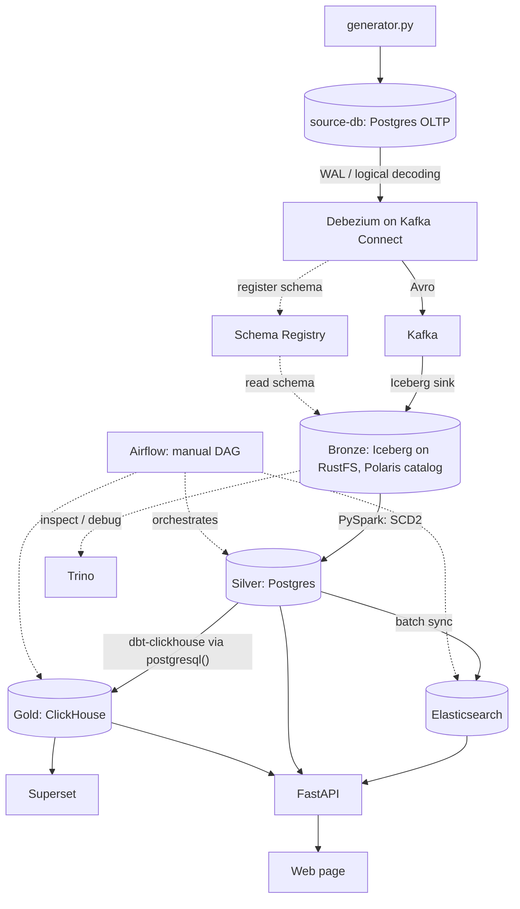

# Data platform — thiết kế

> Bản dịch tiếng Việt của [`dataplatform-design.md`](dataplatform-design.md). Bản tiếng Anh là bản
> gốc; nếu hai bản lệch nhau, theo bản tiếng Anh.

Một dự án để học: dựng một data platform nhỏ nhưng đầy đủ trên Docker Compose và thấy mọi thành
phần chạy từ đầu đến cuối — CDC từ nguồn OLTP, event log trong lakehouse, tầng silver lưu lịch sử,
tầng gold OLAP cho dashboard, và một search index cho web app.

**Phạm vi: demo, không phải production.** Chỉ cần chạy được và dễ theo dõi. Nghĩa là:

- Chỉ Docker Compose (không Kubernetes, không operator), chạy trên Docker Engine cài thẳng trong WSL
  (không dùng Docker Desktop).
- Nguồn là một database Postgres được ghi dữ liệu bởi một script Python generator.
- Các DAG Airflow được kích hoạt **thủ công** (`schedule=None`).
- Không HA, read replica, connection pooler, TLS hay backup.
- Silver **nhất quán sau cùng (eventually consistent) giữa các bảng** (xem §6.2).

## 1. Kiến trúc



Dữ liệu nằm ở ba nơi, mỗi nơi một nhiệm vụ: change event thô ở **bronze** (nguồn sự thật — mọi tầng
sau đều có thể dựng lại từ đây), bản sao có lưu lịch sử ở **silver**, và các model phân tích ở
**gold**. Elasticsearch là search index được suy ra từ silver.

Mỗi tầng có đúng một công cụ truy vấn, để các SQL engine không chồng chéo nhau:

| Tầng | Lưu ở | Truy vấn bằng |
|---|---|---|
| Bronze | Iceberg trên RustFS (Polaris) | **Trino** — chỉ để kiểm tra và debug |
| Silver | Postgres | Postgres thuần (`psql`, API) |
| Gold | ClickHouse | **ClickHouse** — OLAP cho Superset và API |

Với lượng dữ liệu demo, gold hoàn toàn có thể nằm trong Postgres; ClickHouse được giữ lại có chủ
đích để học một OLAP engine dạng cột (MergeTree, background merge, `FINAL`, nạp incremental từ
nguồn bên ngoài).

## 2. Thành phần

| Thành phần | Vai trò | Ghi chú |
|---|---|---|
| `source-db` (Postgres 16) | OLTP giả lập: `users`, `orders`, `order_details` | Instance riêng (`compose/source.yml`), database `source-db`, host port 5433, `wal_level=logical` |
| `generator.py` | Liên tục insert/update/delete vào nguồn | Python + Faker + psycopg, chỉnh được tốc độ |
| Kafka Connect | Chạy Debezium (source) và Iceberg sink | Image tự build trên `confluentinc/cp-kafka-connect` (có sẵn AvroConverter) + plugin Debezium Postgres + file zip Iceberg sink (không được publish thành artifact — build từ source Iceberg trong Dockerfile multi-stage; **Iceberg 1.10.2**, bản mới nhất chạy được trên Java 11 của worker) |
| Kafka UI | Xem bên trong Kafka: topic, message đã giải mã Avro, schema, connector (chỉ đọc) | `kafbat/kafka-ui`, port host 8082 |
| Kafka (+ Zookeeper) | Vận chuyển event Avro | Đã có trong `compose/infra.yml` |
| Schema Registry | Lưu schema Avro, kiểm tra tương thích | Đã có trong `compose/infra.yml` |
| RustFS (S3) + Iceberg | Bronze: change event chỉ ghi thêm (append-only) | Đã có trong stack (`rustfs/rustfs:1.0.4`, thay cho MinIO) |
| Polaris | Iceberg REST catalog cho bronze | Đã có trong stack (OAuth2, scope `PRINCIPAL_ROLE:ALL`) |
| Trino | SQL trên bronze (kiểm tra, debug, kịch bản test) | Đã có trong stack; không nằm trên luồng dữ liệu chính |
| PySpark | Bronze → silver (SCD Type 2) | Spark cluster hiện có, submit qua REST 6066; `spark.master` được đặt trong `spark-defaults.conf` để job submit qua REST chạy trên executor thật; log của driver/executor hiện trên Grafana (`service=spark-job`) |
| Postgres (silver, Postgres 16) | Các bảng silver, đồng thời là database của web app | Database `data-platform` (`POSTGRES_DB`) trên service `postgres` hiện có, bên cạnh `airflow` và `polaris`; Airflow kết nối tới nó qua `postgres_conn` |
| ClickHouse | Gold (OLAP): lưu các bảng gold, phục vụ Superset và API | 26.8 LTS, một node, HTTP 8123; user `admin` (dbt) và `superset_reader` (SELECT trên `gold.*`); đọc silver qua named collection `silver_pg` bằng role Postgres chỉ đọc `clickhouse_reader` |
| dbt-clickhouse | Silver → gold | dbt-core 1.12 + dbt-clickhouse 1.10 trong virtualenv riêng của image Airflow (`/opt/airflow/dbt-venv`, `airflow/dbt-requirements.txt`) — tách khỏi constraints của Airflow; project `./dbt` |
| Superset | Dashboard | 6.1, image tự build thêm `clickhouse-connect` (image gốc không có driver nào); metadata trong SQLite trên một volume (một người dùng — không phải cấu hình production); script khởi động của nó đăng ký **ClickHouse gold** (uuid cố định) và import các dashboard lưu trong git (`superset/dashboards/`) |
| Elasticsearch 7.17 | Tìm kiếm cho web app | Đã có trong `compose/infra.yml`; Python client phải là `elasticsearch` 7.x (8.x từ chối server 7.x) |
| FastAPI | Đường đọc duy nhất của web app | ES cho tìm kiếm, silver cho chi tiết/lịch sử, gold cho số liệu |
| Airflow | Điều phối các bước batch | Chỉ kích hoạt thủ công; tự chạy các task nhẹ (SQL trên Postgres, ES sync); các transform nặng chạy trong Spark và dbt |
| Grafana + Loki + Alloy | Log của mọi container (file log json-file của Docker) và của các job Spark | Đã có trong stack; mọi service chỉ khởi động sau khi Alloy healthy, nên không sót dòng log nào |

Mọi service dùng chung một bridge network là `lakehouse` và gọi nhau bằng tên service
(`kafka:29092`, `http://polaris:8181`, `postgres:5432`, …); port trên host và các connection của
Airflow được liệt kê trong [services.md](services.md).

## 3. Nguồn

### 3.1. Schema

Ba bảng trong schema `shop` của database `source-db` (DDL ở `source/schema.sql`). Tên là `users` và
`orders` vì `user` và `order` là từ khóa dành riêng trong PostgreSQL.

| Bảng | Khóa chính | Cột chính |
|---|---|---|
| `shop.users` | `user_id` | `email` (duy nhất), `full_name`, `phone`, `city`, `status` (active / locked / closed), `created_at`, `updated_at` |
| `shop.orders` | `order_id` | `user_id`, `status` (pending / paid / shipped / completed / cancelled / refunded), `payment_method` (cod / card / bank_transfer / e_wallet), `shipping_city`, `total_amount numeric(18,2)`, `currency char(3)` (mặc định VND), `ordered_at`, `created_at`, `updated_at` |
| `shop.order_details` | `order_detail_id` | `order_id`, `line_number` (duy nhất trong mỗi đơn), `sku`, `product_name`, `category`, `quantity`, `unit_price`, `discount_amount`, `line_total` (mọi cột tiền là `numeric(18,2)`), `created_at`, `updated_at` |

Khóa chính là `bigint GENERATED ALWAYS AS IDENTITY`: generator không bao giờ tự đặt ID.

Lựa chọn thiết kế:

- Các cột trạng thái là `varchar` + `CHECK` thay vì ENUM — dễ thay đổi hơn, và tiện cho các thí
  nghiệm schema evolution.
- `line_total` (= `quantity × unit_price − discount_amount`) là cột thường do generator tính.
  Generated column không được logical replication gửi đi trước PostgreSQL 18.
- `updated_at` được duy trì bằng trigger.
- `order_details.order_id` có `ON DELETE CASCADE`, nên xóa một đơn hàng sinh ra delete trên hai
  bảng trong cùng một transaction.

### 3.2. Thiết lập CDC

- `wal_level = logical` (truyền qua `postgres -c wal_level=logical` trong compose).
- `max_slot_wal_keep_size = 1GB`: giới hạn lượng WAL mà một slot chưa được đọc có thể giữ lại, để
  Debezium bị dừng không làm đầy ổ đĩa laptop. Vượt ngưỡng, Postgres vô hiệu hóa slot và Debezium
  phải snapshot lại — bản thân đó cũng là một kịch bản test (§10).
- `REPLICA IDENTITY FULL` trên cả ba bảng, để event update/delete mang đầy đủ dòng cũ.
- Publication `dbz_publication` chỉ gồm ba bảng, được tạo bởi `source/schema.sql` (Debezium không
  được tự tạo: mặc định của nó là `FOR ALL TABLES`, đòi quyền superuser).
- Một user riêng `debezium` có `LOGIN` + `REPLICATION` và `SELECT` trên `shop` (cả các bảng tạo sau
  này, nhờ `ALTER DEFAULT PRIVILEGES`); mật khẩu là `SOURCE_POSTGRES_DB_DEBEZIUM_PASSWORD`.
- Bảng heartbeat `public.debezium_heartbeat` (một dòng, cấp `INSERT`/`UPDATE` cho `debezium`), cũng
  nằm trong publication — xem `heartbeat.action.query` ở §4.2.
- Bảng signal `public.debezium_signal` (`id`, `type`, `data`; cấp `SELECT/INSERT/UPDATE/DELETE` cho
  `debezium`), cũng nằm trong publication: một dòng có `type = 'execute-snapshot'` khiến Debezium
  snapshot một bảng được thêm vào sau (`docs/add-source-table.md`).

Toàn bộ phần này — schema, bảng, trigger, thiết lập CDC — nằm trong **`source/schema.sql`**, được
job một lần **`source-db-setup`** (`compose/source.yml`, image `postgres:16`,
`psql -v ON_ERROR_STOP=1`) áp dụng ở mỗi lần `up`. Script idempotent (`IF NOT EXISTS`,
`CREATE OR REPLACE TRIGGER`, và `SELECT … WHERE NOT EXISTS … \gexec` cho publication và role, vì
hai loại này không có `IF NOT EXISTS`). Mật khẩu Debezium đi vào SQL dưới dạng biến của psql:
compose đưa `.env` vào container, job chạy `psql -v debezium_password="$DEBEZIUM_PASSWORD"`, và
script đọc `:'debezium_password'` (được bọc nháy an toàn; psql không thay biến bên trong
`DO $$ … $$`, nên mới dùng `\gexec`).

### 3.3. Generator

`generator.py` lặp vô hạn với tốc độ cấu hình được (`--rate` event/giây) và ngẫu nhiên:

- tạo một đơn hàng — trong **một transaction**: insert `orders`, insert 1–5 `order_details`, rồi
  update `orders.total_amount`;
- chuyển trạng thái đơn hàng tiến lên (pending → paid → shipped → completed; hoặc → cancelled;
  một đơn completed có thể chuyển sang refunded);
- cập nhật một user (thành phố, điện thoại) hoặc khóa một user;
- thỉnh thoảng xóa một đơn hàng (cascade xuống các dòng của nó).

Nó là một service Compose nằm dưới một profile, được bật/tắt thủ công
(`docker compose --profile generator up -d generator`), nên stack có thể chạy mà không sinh dữ
liệu mới.

Triển khai (`source/generator.py`, image `custom-generator`): mỗi nhịp chọn một hành động theo
tỉ trọng — tạo đơn 45 %, chuyển trạng thái đơn 30 %, sửa user 10 %, tạo user 8 %, xóa đơn 4 %,
khóa/mở khóa user 3 % — với tốc độ `GENERATOR_RATE` event/giây; lúc khởi động nó tạo trước 20 user.
Họ tên lấy từ Faker `vi_VN`; thành phố, sản phẩm (17 SKU thuộc 7 nhóm) và số điện thoại lấy từ danh
sách cố định, để dữ liệu sạch. Hai chi tiết quan trọng cho CDC: kết nối chạy ở chế độ
**autocommit**, nên mỗi hành động là một transaction được commit riêng (nếu không, transaction ngầm
của psycopg biến mọi hành động thành savepoint và không có gì được commit cho tới khi generator
dừng); và nó xử lý `SIGTERM` (chạy làm PID 1 thì mặc định sẽ bỏ qua tín hiệu này), nên
`docker compose stop` dừng gọn sau hành động đang chạy. Cách chạy — trong container hoặc trực
tiếp bằng Python — có trong [services.md](services.md#running-the-generator).

## 4. Event: Avro + Schema Registry

### 4.1. Vì sao dùng Avro

Mặc định Debezium xuất JSON kèm toàn bộ schema trong mỗi message: message lớn và không có gì ngăn
một thay đổi schema làm hỏng consumer. Với Avro, một message là dữ liệu nhị phân gọn cộng tiền tố 5
byte (magic byte + schema ID); bản thân schema chỉ lưu một lần trong registry. Registry cũng kiểm
tra mỗi schema mới so với schema trước, nên một thay đổi không tương thích bị từ chối ngay đầu
pipeline thay vì âm thầm làm hỏng dữ liệu ở downstream.

Subject dùng `TopicNameStrategy` (topic `src.shop.orders` → subject `src.shop.orders-key` và
`src.shop.orders-value`), compatibility `BACKWARD`.

### 4.2. Debezium connector

```json
{
  "connector.class": "io.debezium.connector.postgresql.PostgresConnector",
  "tasks.max": "1",
  "database.hostname": "source-db",
  "database.port": "5432",
  "database.dbname": "${env:SOURCE_POSTGRES_DB}",
  "database.user": "debezium",
  "database.password": "${env:SOURCE_POSTGRES_DB_DEBEZIUM_PASSWORD}",
  "plugin.name": "pgoutput",
  "publication.name": "dbz_publication",
  "publication.autocreate.mode": "disabled",
  "slot.name": "dbz_slot",
  "topic.prefix": "src",
  "table.include.list": "shop.users,shop.orders,shop.order_details",
  "tombstones.on.delete": "false",
  "decimal.handling.mode": "precise",
  "signal.data.collection": "public.debezium_signal",
  "heartbeat.interval.ms": "10000",
  "heartbeat.action.query": "INSERT INTO public.debezium_heartbeat (id, ts) VALUES (1, now()) ON CONFLICT (id) DO UPDATE SET ts = EXCLUDED.ts",
  "transforms": "dropSignals",
  "transforms.dropSignals.type": "org.apache.kafka.connect.transforms.Filter",
  "transforms.dropSignals.predicate": "isSignalTopic",
  "predicates": "isSignalTopic",
  "predicates.isSignalTopic.type": "org.apache.kafka.connect.transforms.predicates.TopicNameMatches",
  "predicates.isSignalTopic.pattern": "src\\.public\\.debezium_signal",
  "key.converter": "io.confluent.connect.avro.AvroConverter",
  "key.converter.schema.registry.url": "http://schema-registry:8081",
  "value.converter": "io.confluent.connect.avro.AvroConverter",
  "value.converter.schema.registry.url": "http://schema-registry:8081"
}
```

- `${env:...}`: secret lấy từ biến môi trường của container Connect (được điền từ `.env`) thông qua
  `EnvVarConfigProvider` của Kafka (worker config `config.providers=env`), nên không có mật khẩu
  nào nằm trong JSON của connector.
- `publication.autocreate.mode=disabled`: dùng publication ở §3.2, báo lỗi rõ ràng nếu thiếu.
- `tombstones.on.delete=false`: nếu không, sau mỗi delete Debezium sẽ gửi thêm một message có value
  `null`, chỉ dùng cho Kafka log compaction — thứ dự án này không dùng.
- `decimal.handling.mode=precise`: không bao giờ dùng `double` cho tiền.
- `heartbeat.interval.ms` + `heartbeat.action.query`: pgoutput bỏ qua các transaction không đụng tới
  bảng nào trong publication, nên khi `shop.*` không có thay đổi, Debezium không thấy LSN mới, không
  xác nhận được, và slot giữ lại toàn bộ WAL sinh ra trong lúc đó (đo được: lag kẹt ở ~2,7 MB). Chỉ
  bật heartbeat thì Debezium chỉ gửi lại offset cũ; action query upsert dòng của
  `public.debezium_heartbeat` mỗi 10 giây, tạo ra một thay đổi đi qua slot nên LSN tiến lên (lag về
  dưới 1 KB). Bảng nằm trong publication nhưng không có trong `table.include.list`, nên không có
  topic Kafka; bản thân heartbeat đi vào topic `__debezium-heartbeat.src`.
- `timestamptz` luôn được map thành chuỗi `ZonedTimestamp`; `time.precision.mode` chỉ ảnh hưởng
  `timestamp`/`time` không có múi giờ, thứ schema không dùng, nên giữ mặc định.
- Lần khởi động đầu, Debezium snapshot các dòng đang có (event với `op = r`), sau đó stream WAL.
  Bảng được thêm vào `table.include.list` sau này chỉ nhận các thay đổi từ lúc đó; các dòng có sẵn
  của nó đi qua **incremental snapshot** được yêu cầu bằng bảng signal (`signal.data.collection`) —
  chạy song song với streaming và chỉ đọc lại bảng đó. Các bước: `docs/add-source-table.md`.
- `transforms` `dropSignals` (SMT `Filter` có sẵn của Kafka + predicate `TopicNameMatches`):
  Debezium luôn bắt thay đổi của bảng signal, kể cả khi bảng không nằm trong `table.include.list`,
  và sẽ publish ra `src.public.debezium_signal`; filter bỏ các record đó, nên topic không bao giờ
  được tạo.
- Debezium **2.7.4.Final**: image gốc `cp-kafka-connect:7.6.0` chạy Java 11, còn Debezium 3.x cần
  Java 17. File tarball của plugin tải từ Maven Central, có kiểm tra checksum, trong
  `connect/Dockerfile`.
- Generator ghi một đơn hàng bằng INSERT + UPDATE (`total_amount` được gán sau khi có các dòng chi
  tiết) trong cùng một transaction, nên một đơn mới sinh ra một event `c` và một event `u` cùng
  `txId` — lý do silver chỉ giữ event cuối của mỗi khóa trong một transaction (§6.2).

Các connector được đăng ký bởi job one-shot `connect-setup` qua Kafka Connect REST API (cùng
pattern với các job `*-setup` khác: idempotent, kiểm tra mọi mã HTTP): mỗi file
`connect/connectors/<name>.json` được `PUT` vào `/connectors/<name>/config` (tạo mới hoặc cập nhật),
rồi job chờ tới khi connector và task của nó `RUNNING`. Một job đăng ký mọi connector, nên nó chờ
mọi thứ mà bất kỳ connector nào cần (`source-db-setup` cho Debezium, `polaris-setup` cho Iceberg
sink): catalog hỏng thì Debezium cũng không được đăng ký. Chấp nhận cho demo; mỗi connector một
setup job riêng sẽ tách được hai bên.

### 4.3. Ánh xạ kiểu dữ liệu

| Postgres | Avro (qua Debezium) | Lưu ý khi đọc trong Spark |
|---|---|---|
| `bigint` | `long` | |
| `integer`, `smallint` | `int` | Avro không có kiểu short |
| `varchar`, `text` | `string` | |
| `numeric(18,2)` | `bytes` + logical type `decimal` | Chính xác, nhờ chế độ `precise`; trong bronze thành `decimal(38,2)` (sink giữ scale nhưng không giữ precision) |
| `timestamptz` | `string` (`io.debezium.time.ZonedTimestamp`, ISO-8601) | Parse thành timestamp |

### 4.4. Envelope

Toàn bộ envelope của Debezium được giữ trong bronze (`before`, `after`, `source`, `op`, `ts_ms`) —
không làm phẳng bằng `ExtractNewRecordState` — vì silver cần `op`, giá trị cũ và `source.lsn`.

### 4.5. Luồng thay đổi schema

Thêm một cột nullable ở nguồn: event tiếp theo mang schema mới, registry kiểm tra và gán ID mới, và
Iceberg sink thêm cột vào bảng bronze (`iceberg.tables.evolve-schema-enabled=true`). Job silver
mang cột mới vào bảng staging, và bước apply thêm các cột staging còn thiếu vào silver bằng
`ALTER TABLE ... ADD COLUMN` (§6.4).

Một thay đổi phá vỡ `BACKWARD` bị registry từ chối và task Debezium fail — thấy được trong status
của Kafka Connect và trong log Grafana. Ví dụ: `quantity integer → text` bị từ chối (Avro không đọc
được `int` cũ thành `string`), còn `integer → bigint` thì qua (`int → long` là phép nâng kiểu Avro
cho phép). Khôi phục thủ công: sửa nguồn, hoặc nới compatibility của subject, rồi restart task.

Lưu ý: đổi tên cột với Avro là "drop + add", điều mà `BACKWARD` cho phép. Cột cũ âm thầm thành
null — một trong các kịch bản test ở §10.

## 5. Bronze — event log trên Iceberg

Mỗi change event một dòng, chỉ ghi thêm. Một Iceberg sink connector duy nhất ghi mỗi topic vào bảng
riêng trong namespace `bronze` của Polaris catalog `lakehouse`:

| Topic | Bảng bronze |
|---|---|
| `src.shop.users` | `lakehouse.bronze.users_cdc` |
| `src.shop.orders` | `lakehouse.bronze.orders_cdc` |
| `src.shop.order_details` | `lakehouse.bronze.order_details_cdc` |

Avro được giải mã thành các cột Iceberg có kiểu (Parquet), không lưu dạng byte thô; `before`,
`after` và `source` vẫn là struct lồng nhau.

SMT `InsertField` có sẵn của Kafka thêm `_topic`, `_partition`, `_offset` và `_ingested_at`
(timestamp của Kafka record). Nó được dùng thay cho `KafkaMetadataTransform` của sink vì cái đó ghi
timestamp dạng `long` thường, trong khi partition transform `day()` của Iceberg cần timestamp thật.
Các bảng được partition theo `day(_ingested_at)`.

Cấu hình sink connector (`connect/connectors/iceberg-bronze.json`, connector `iceberg-bronze`):

```json
{
  "connector.class": "org.apache.iceberg.connect.IcebergSinkConnector",
  "tasks.max": "1",
  "topics": "src.shop.users,src.shop.orders,src.shop.order_details",
  "key.converter": "io.confluent.connect.avro.AvroConverter",
  "key.converter.schema.registry.url": "http://schema-registry:8081",
  "value.converter": "io.confluent.connect.avro.AvroConverter",
  "value.converter.schema.registry.url": "http://schema-registry:8081",

  "transforms": "meta",
  "transforms.meta.type": "org.apache.kafka.connect.transforms.InsertField$Value",
  "transforms.meta.topic.field": "_topic",
  "transforms.meta.partition.field": "_partition",
  "transforms.meta.offset.field": "_offset",
  "transforms.meta.timestamp.field": "_ingested_at",

  "iceberg.tables": "bronze.users_cdc,bronze.orders_cdc,bronze.order_details_cdc",
  "iceberg.tables.route-field": "_topic",
  "iceberg.table.bronze.users_cdc.route-regex": "^src\\.shop\\.users$",
  "iceberg.table.bronze.orders_cdc.route-regex": "^src\\.shop\\.orders$",
  "iceberg.table.bronze.order_details_cdc.route-regex": "^src\\.shop\\.order_details$",
  "iceberg.tables.auto-create-enabled": "true",
  "iceberg.tables.evolve-schema-enabled": "true",
  "iceberg.tables.default-partition-by": "day(_ingested_at)",
  "iceberg.tables.auto-create-props.format-version": "2",
  "iceberg.control.topic": "control-iceberg",
  "iceberg.control.commit.interval-ms": "60000",

  "iceberg.catalog.type": "rest",
  "iceberg.catalog.uri": "http://polaris:8181/api/catalog",
  "iceberg.catalog.warehouse": "lakehouse",
  "iceberg.catalog.rest.auth.type": "oauth2",
  "iceberg.catalog.oauth2-server-uri": "http://polaris:8181/api/catalog/v1/oauth/tokens",
  "iceberg.catalog.credential": "root:${env:POLARIS_SECRET}",
  "iceberg.catalog.scope": "PRINCIPAL_ROLE:ALL",
  "iceberg.catalog.io-impl": "org.apache.iceberg.aws.s3.S3FileIO",
  "iceberg.catalog.s3.endpoint": "${env:S3_ENDPOINT}",
  "iceberg.catalog.s3.path-style-access": "true",
  "iceberg.catalog.s3.access-key-id": "${env:S3_ACCESS_KEY}",
  "iceberg.catalog.s3.secret-access-key": "${env:S3_SECRET_KEY}",
  "iceberg.catalog.client.region": "${env:S3_REGION}"
}
```

- Routing là tĩnh: sink so `_topic` với `route-regex` của từng bảng (có neo đầu/cuối, nên mỗi topic
  map đúng vào một bảng).
- `format-version=2`: Trino 454 không đọc được bảng v3, và v2 có đủ những gì bronze cần. Spark chạy
  cùng phiên bản Iceberg với sink (**1.10.2**), vì nó sẽ compact và expire snapshot trên chính các
  bảng này trong lúc sink vẫn commit (phase 8).
- `commit.interval-ms=60000`: mặc định là 5 phút; một phút giúp demo phản hồi nhanh hơn. Mỗi lần
  commit có dữ liệu thêm một snapshot `append` và một file Parquet cho mỗi bảng mỗi ngày (~20 KB mỗi
  file ở tốc độ demo) — rất nhiều file nhỏ, phase 8 sẽ compact.
- `rest.auth.type=oauth2` + `oauth2-server-uri`: nếu không khai báo, Iceberg 1.10 tự suy ra cả hai và
  log cảnh báo rằng cơ chế tự suy ra token endpoint sẽ bị bỏ ở bản sau.
- Token OAuth2: các client Iceberg REST ở đây (sink, và Trino 454) làm mới token một lần, ~5 phút
  trước khi hết hạn, rồi không bao giờ làm mới nữa — với thời hạn mặc định 1 giờ của Polaris, chúng
  bị HTTP 401 khoảng 2 giờ sau khi khởi động (access log của Polaris, 2026-11-03). Vì vậy Polaris
  cấp token 30 ngày (`polaris.authentication.token-broker.max-token-generation=P30D`,
  `compose/catalog.yml`), ký bằng một khóa HMAC cố định trong `.env`
  (`token-broker.type=symmetric-key`, `POLARIS_TOKEN_SIGNING_KEY`): cặp khóa RSA mặc định được sinh
  lại mỗi lần Polaris khởi động, làm mọi token mất hiệu lực và khiến task của sink lỗi sau mỗi lần
  restart.
- `offset.flush.interval.ms=10000` của worker (mặc định 60 giây): khi các topic không có dữ liệu mới,
  Connect chỉ gọi `put()` của sink mỗi chu kỳ flush một lần, và sink chỉ đọc control topic bên trong
  `put()`. Ở 60 giây, consumer control của nó liên tục rơi khỏi group (session timeout 45 giây), nên
  các record đến ngay trước một quãng rảnh không bao giờ được commit. Ở 10 giây, các lần commit lúc
  rảnh xong trong ~15 giây.
- Việc ghi vào Iceberg là exactly-once (Kafka offset được commit cùng với Iceberg snapshot; đã kiểm
  tra bằng cách restart Kafka Connect giữa lúc đang ghi — không thiếu, không trùng `_offset`). Bản
  trùng vẫn có thể xuất hiện vì bản thân Debezium là at-least-once: sau khi crash, nó gửi lại các
  event kể từ LSN được flush cuối cùng. Silver xử lý chuyện đó (§6.2).
- Cách một lần commit diễn ra: coordinator (task giữ partition 0 của topic đầu tiên) gửi
  `START_COMMIT` lên control topic `control-iceberg` mỗi chu kỳ; mỗi worker trả lời bằng danh sách
  file nó đã ghi; coordinator commit chúng thành một snapshot cho mỗi bảng. Quan sát được: khi có
  dữ liệu chảy qua, một lần commit xong trong dưới 2 giây; khi các topic không có dữ liệu mới (và
  ngay sau khi khởi động) nó chờ hết `commit.timeout-ms` (30 giây), log `Commit timeout reached` và
  commit những gì đã nhận — thường là không có gì. Vô hại: không mất gì, lần commit sau sẽ lấy tiếp.
- Consumer group trong Kafka UI: `connect-iceberg-bronze` (các topic dữ liệu; offset chỉ tiến khi
  commit Iceberg thành công), `connect-iceberg-bronze-coord` và `cg-control-*` (control topic).
- `_ingested_at` là timestamp của record Kafka, tức lúc Debezium tạo event — không phải lúc sink ghi.
  Vì vậy các dòng của lần đọc bù đầu tiên mang thời điểm gốc của chúng. Nó không nói gì về thứ tự
  commit giữa các bảng; thứ tự luôn theo `source.lsn` (§6.2).
- `day(_ingested_at)` cắt ngày theo **UTC** (Iceberg lưu `timestamptz` theo UTC), trong khi stack chạy
  `Asia/Ho_Chi_Minh` (UTC+7): event từ 0h đến 7h giờ Việt Nam nằm ở partition của ngày hôm trước.
  Silver không bị ảnh hưởng (đọc theo snapshot), nhưng khi lọc theo ngày giờ Việt Nam trong Trino
  thì phải đổi múi giờ: `WHERE _ingested_at >= TIMESTAMP '2026-11-03 00:00 Asia/Ho_Chi_Minh'`.
  Giữ nguyên có chủ đích: `day()` của Iceberg không có tham số múi giờ, và partition pruning vẫn
  hoạt động — filter như trên chỉ đọc hai partition ngày UTC chồng lên khoảng đó. Các cách khác đã
  loại: thêm cột giờ Việt Nam cần tự viết SMT (không có SMT có sẵn nào đổi múi giờ);
  `hour(_ingested_at)` khớp được ngày Việt Nam nhưng số partition gấp 24 lần. Luôn lọc theo
  `_ingested_at`, không lọc theo giá trị partition.
- Sink, Trino và Spark đều dùng principal `root` của Polaris — đơn giản và đủ cho demo. Theo nguyên
  tắc quyền tối thiểu thì mỗi engine nên có principal riêng (ví dụ sink chỉ được ghi `bronze`); đây
  là hướng mở rộng, không nằm trong kế hoạch.

Bronze truy vấn được từ Trino ngay, ví dụ
`SELECT op, after.order_id, source.lsn FROM lakehouse.bronze.orders_cdc ORDER BY source.lsn DESC LIMIT 20`.
Các cột thời gian bên trong `before`/`after` vẫn là chuỗi ISO-8601 (`ZonedTimestamp`, §4.3); silver
sẽ parse.

## 6. Silver — SCD Type 2 trên Postgres

### 6.1. LSN trong một đoạn

PostgreSQL ghi mọi thay đổi vào WAL (write-ahead log) trước khi đụng tới file dữ liệu. **LSN** (Log
Sequence Number) là vị trí byte của một thay đổi trong WAL (ví dụ `0/16B3748`): tăng nghiêm ngặt
và không phụ thuộc đồng hồ. Debezium đặt nó vào `source.lsn` của mỗi event dưới dạng số nguyên
(`bigint`), nên sắp xếp và so sánh trực tiếp được. Replication slot nhớ LSN cuối cùng Debezium đã
xác nhận; Postgres giữ toàn bộ WAL sau đó, nên Debezium bị dừng sẽ làm WAL phình ra cho tới khi đầy
đĩa.

### 6.2. Quy tắc thứ tự và nhất quán

- **Sắp xếp event theo `source.lsn` theo từng key**, không bao giờ theo timestamp. Hai transaction
  không thể đồng thời sửa cùng một dòng (row lock), nên với một key, thứ tự LSN = thứ tự commit.
- **Idempotent:** silver lưu LSN của event cuối cùng đã apply cho mỗi key và chỉ apply event mới
  hơn. Debezium là at-least-once (§5), nên bản trùng là chuyện bình thường và vô hại.
- **Một version cho mỗi key trong mỗi transaction.** Generator insert một đơn hàng rồi update
  `total_amount` của nó trong cùng transaction: hai event, cùng key, cùng thời điểm commit. Chỉ
  event cuối của một key trong một transaction (`source.txId`) trở thành version; nếu không silver
  sẽ có version độ dài bằng 0 (`_valid_from = _valid_to`). Job Spark chỉ gộp được các event nó
  thấy trong một batch, mà một lần commit của sink có thể cắt đôi một transaction (ngày
  2026-11-04 bronze đã có 2 cặp key/transaction như vậy), nên một lần chạy có thể chỉ thấy phần
  đầu. Vì thế silver giữ `_tx_id`, và bước apply **xóa** version hiện tại nếu transaction của nó
  còn tiếp tục trong staging, thay vì đóng nó (§6.4, câu 0).
- **Nhất quán sau cùng giữa các bảng.** Mỗi bảng được xử lý riêng. Ba topic di chuyển độc lập, nên
  tại một thời điểm bronze có thể có một đơn hàng mà các dòng chi tiết chưa tới; silver có thể tạm
  hiển thị nó không có dòng nào. Lần chạy kế tiếp lấp chỗ trống. Điều này được chấp nhận cho demo.
  (Nhất quán chặt theo từng transaction sẽ cần `provide.transaction.metadata` của Debezium và chỉ
  apply những transaction đã đủ số event — có thể làm bài tập sau.)
- Delete trở thành version cuối với `_is_deleted = true` (giá trị lấy từ `before`).

### 6.3. Các bảng silver

Database `data-platform`, schema `silver`, mỗi bảng nguồn một bảng, ví dụ `silver.orders`:

| Cột | Ý nghĩa |
|---|---|
| các cột nguồn | `order_id`, `user_id`, `status`, … |
| `_valid_from`, `_valid_to` | Khoảng hiệu lực của version, lấy từ `source.ts_ms` (thời điểm commit của transaction nguồn); `_valid_to` null với version hiện tại |
| `_is_current` | Đúng một version hiện tại cho mỗi key |
| `_is_deleted` | Key đã bị xóa ở nguồn |
| `_lsn` | LSN của event sinh ra version này |
| `_tx_id` | Transaction nguồn (`source.txId`) của event đó — để hoàn tất một transaction bị tách qua hai lần chạy (§6.2) |
| `_silver_updated_at` | Lần cuối silver ghi dòng này — watermark cho gold và ES (§7, §8) |

Một partial unique index `(order_id) WHERE _is_current` đảm bảo "một version hiện tại" luôn đúng và
giúp các truy vấn đọc của web app nhanh. Cột do platform thêm vào bắt đầu bằng `_`; cột nguồn giữ
nguyên tên.

DDL nằm ở `postgres/schema.sql`, được job one-shot `postgres-setup` chạy (idempotent) mỗi lần `up`.
Ngoài ràng buộc trên còn có: `PRIMARY KEY (<key>, _lsn)` (áp lại một event sẽ lỗi thay vì tạo
version trùng), `CHECK ((_valid_to IS NULL) = _is_current)` và `_valid_to >= _valid_from`. Chuỗi
nguồn là `text`, cột nguồn cho phép null, không có CHECK hay foreign key: silver phản chiếu nguồn
và không được lỗi khi nguồn nới rộng một cột hoặc khi đơn hàng đến trước user của nó (§6.2).

Trạng thái chạy nằm trong `config.etl_checkpoint`, mỗi `(pipeline, table_name)` một dòng:
`last_snapshot_id` cho bước silver (snapshot bronze để đọc tiếp sau nó; `NULL` = đọc toàn bộ —
snapshot ID là số ngẫu nhiên, nên đọc incremental đi theo chuỗi parent chứ không so sánh ID),
`last_watermark` cho ES sync, cùng `source_table`, `key_columns` và `is_active`.

### 6.4. Job bronze → silver

Code: `spark/jobs/job_silver.py` (bước 1–3) và `airflow/dags/lib/silver_apply.py` (bước 4), do
DAG `platform_pipeline` chạy (§9). Job **dùng chung**: nó xử lý mọi dòng của
`config.etl_checkpoint` có `pipeline = 'silver' AND is_active`, dùng `source_table` và
`key_columns` của dòng đó, nên thêm bảng nguồn mới chỉ cần thêm một dòng checkpoint, không cần
code. Mỗi lần chạy, cho từng bảng:

1. Chỉ đọc dữ liệu bronze mới: một Iceberg incremental read (`start-snapshot-id`, không bao gồm,
   tới `end-snapshot-id` = snapshot hiện tại của bảng, lấy từ `<table>.refs` với
   `name = 'main'`) bắt đầu từ snapshot ID đã apply cuối cùng trong `config.etl_checkpoint`. Khi
   giá trị đó là NULL (lần đầu) thì đọc toàn bộ bảng tại snapshot hiện tại. Không có snapshot mới
   → không có gì để stage (`row_count = 0`). Bronze là append-only, đúng thứ incremental read hỗ
   trợ.
2. Biến event thành các dòng version: `after` cho `c`/`u`/`r`, `before` + `_is_deleted = true` cho
   `d`; chỉ giữ event cuối của mỗi key trong mỗi transaction (§6.2). Trong batch, `_valid_to` =
   `_valid_from` của version kế tiếp cùng key (window `lead` sắp theo `source.lsn`); version cuối
   của mỗi key là `_is_current`. `_valid_from` lấy từ `source.ts_us` (micro giây, nên hai
   transaction trong cùng một mili giây không bị trùng) và được ghi dạng text có offset rõ ràng
   (`2026-11-04 10:00:00.000000+07:00`): cùng một thời điểm bất kể time zone của session. Event
   trùng gộp theo (key, `source.lsn`). Event snapshot (`op = r`) dùng chung một LSN và txId;
   `_valid_from` của chúng là thời điểm snapshot — lịch sử trước snapshot là không biết.
3. Ghi `staging.<table>` qua JDBC với `mode=overwrite` (bảng được tạo lại mỗi lần chạy, nên nhận
   được cột nguồn mới). Sau đó, **cuối cùng**, ghi lại `staging.batch`: mỗi bảng active một dòng —
   `start_snapshot_id` (checkpoint mà lần đọc bắt đầu sau nó), `end_snapshot_id` (đọc tới đâu),
   `row_count`, `created_at`. Job đọc toàn bộ bảng, thay các dòng của bảng vừa xử lý, giữ nguyên
   các dòng khác (lần chạy `--table` không được làm mất batch đang chờ của bảng khác), bỏ dòng của
   bảng không còn active, rồi ghi lại (JDBC overwrite với `truncate=true`, giữ nguyên DDL;
   `created_at` đi dưới dạng text với `stringtype=unspecified` để dòng được giữ lại giữ nguyên
   thời gian). Trước lần ghi đó
   `staging.batch` vẫn mô tả lần chạy trước, mà khoảng của nó không bao giờ vượt quá checkpoint,
   nên một lần chạy lỗi chỉ làm silver chậm lại chứ không bao giờ bỏ sót dữ liệu.
4. Bàn giao cho Airflow (`silver_apply`), cho từng bảng, trong **một transaction Postgres**: bỏ
   qua batch đã apply (`end_snapshot_id` = checkpoint); báo lỗi nếu `start_snapshot_id` ≠
   checkpoint (staging lỗi thời — chạy lại bước Spark); nếu `row_count > 0` thì thêm các cột
   staging còn thiếu vào silver (`ALTER TABLE ... ADD COLUMN`, kiểu của staging) và chạy các câu
   lệnh SCD2 bên dưới; rồi chép `end_snapshot_id` sang `config.etl_checkpoint`. Nếu có gì lỗi,
   bảng đó không thay đổi gì, và lần chạy sau đọc lại đúng khoảng đó. Các bảng được apply độc lập
   (silver eventually consistent giữa các bảng, §6.2); task fail ở cuối nếu có bảng lỗi.

Bước apply SCD2 gồm ba câu lệnh, vì `MERGE` chỉ làm được một hành động cho mỗi dòng nguồn khớp,
trong khi SCD2 cần cả "đóng version cũ" lẫn "chèn version mới":

```sql
-- 0) a current version whose transaction continues in staging (the sink split the transaction
--    across two runs) is replaced, not closed — closing would leave _valid_to = _valid_from.
--    The previous version's _valid_to already equals the new event's _valid_from (same commit).
DELETE FROM silver.orders s
USING staging.orders st
WHERE s.order_id = st.order_id AND s._is_current
  AND st._tx_id = s._tx_id AND st._lsn > s._lsn;

-- 1) close the current version, using the OLDEST staging event that is newer than it.
--    Staging may also hold already-applied events (re-runs, Debezium duplicates); comparing
--    only min(_lsn) of the whole batch would miss the close and leave two current versions.
WITH nxt AS (
  SELECT DISTINCT ON (st.order_id) st.order_id, st._valid_from
  FROM staging.orders st
  JOIN silver.orders s ON s.order_id = st.order_id AND s._is_current
  WHERE st._lsn > s._lsn
  ORDER BY st.order_id, st._lsn
)
UPDATE silver.orders s
SET _valid_to = nxt._valid_from, _is_current = false, _silver_updated_at = now()
FROM nxt
WHERE s.order_id = nxt.order_id AND s._is_current;

-- 2) insert versions not applied yet (skip anything already seen -> idempotent)
INSERT INTO silver.orders (<columns from staging>, _silver_updated_at)
SELECT <st.column::silver type, for each staging column>, now()
FROM staging.orders st
WHERE NOT EXISTS (SELECT 1 FROM silver.orders s
                  WHERE s.order_id = st.order_id AND s._lsn >= st._lsn);
```

(Câu 0: version hiện tại mà transaction của nó còn tiếp tục trong staging thì bị thay thế chứ
không bị đóng — đóng sẽ để lại `_valid_to = _valid_from`; version trước đó đã có `_valid_to` bằng
`_valid_from` của event mới vì cùng thời điểm commit. Câu 1: đóng version hiện tại bằng event staging **cũ nhất** mà mới hơn nó. Staging có thể chứa cả
event đã apply rồi — do chạy lại hoặc bản trùng từ Debezium; nếu chỉ so `min(_lsn)` của cả batch
thì sẽ bỏ sót việc đóng version và để lại hai version hiện tại. Câu 2: chèn các version chưa apply,
bỏ qua những gì đã thấy → idempotent.)

Danh sách cột được task apply sinh ra từ các cột của `staging`, nên theo kịp schema evolution mà
không cần sửa tay. Mọi giá trị được cast sang kiểu cột của silver (`st.total_amount::numeric(18,2)`,
`st.ordered_at::timestamptz`, cả `st._valid_from::timestamptz` trong câu 1): staging giữ đúng thứ
Spark ghi (tiền `numeric(38,2)`, chuỗi timestamp ISO của Debezium dạng `text`), silver giữ kiểu
của nguồn. Cột thêm sau sẽ có kiểu của staging (một cột timestamp mới sẽ là `text` cho đến khi
sửa tay).

Dựng lại toàn bộ một bảng từ bronze — tham số DAG `full_refresh` (§9): `job_silver.py
--full-refresh` bỏ qua checkpoint và đưa toàn bộ bảng bronze vào staging, ghi một dòng batch **không
có snapshot bắt đầu**. Bước apply chỉ dựa vào đó để nhận ra full refresh (start NULL trong khi
checkpoint đã có — batch cộng dồn luôn bắt đầu tại checkpoint; lần chạy đầu tiên thì chưa có
checkpoint) và, trong cùng transaction, `DELETE` bảng silver trước khi insert (`DELETE` chứ không
`TRUNCATE`: người đọc vẫn thấy dữ liệu cũ tới lúc commit thay vì phải chờ khóa độc quyền). Nó không
bị bỏ qua khi bronze không có snapshot mới, và bị từ chối nếu bronze không có snapshot nào. Quyết
định dựa trên `staging.batch` thay vì tham số DAG nên chạy lại riêng `silver_apply` không thể xóa
sạch silver bằng một batch cộng dồn. Chỉ reset checkpoint thì không có tác dụng: mọi event đều bị
bỏ qua nhờ `_lsn`.

## 7. Elasticsearch — tìm kiếm

Một task Airflow sau bước silver dựng mỗi đơn hàng thành một document (các trường của đơn hàng + tên
và thành phố của user + tên sản phẩm của các dòng — ES không có join), bỏ các trường nhạy cảm
(email, điện thoại), và bulk-upsert với `_id` = `order_id`.

Đơn hàng nào cần dựng lại: mọi đơn hàng mà chính dòng của nó, bất kỳ dòng chi tiết nào, **hoặc user
của nó** có `_silver_updated_at` > watermark của lần sync trước — một user đổi thành phố phải làm
mới mọi document đơn hàng của user đó. Đơn hàng có version hiện tại `_is_deleted` bị xóa khỏi index.
Watermark là `_silver_updated_at` lớn nhất đã xử lý, lưu trong `config.etl_checkpoint`. Muốn đổi
cấu trúc document thì cứ tạo lại index (demo — không chuyển alias).

## 8. Gold — ClickHouse

**Hiện trạng (2026-11-06):** các gold model đang dựng lại toàn bộ (`materialized: table` trên
`MergeTree`) — `dim_users`, `fct_orders` từ `stg_users` / `stg_orders` dạng ephemeral, đọc các dòng
hiện tại, chưa bị xóa của silver. Thiết kế incremental dưới đây làm tiếp sau.

dbt-clickhouse dựng gold thẳng từ silver mà không cần bản sao trung gian. Các staging model là
`ephemeral` và đọc silver qua table function `postgresql()` (thông tin kết nối nằm trong một
ClickHouse named collection). Các gold model là `incremental` trên `ReplacingMergeTree`:

```sql
-- models/gold/fct_orders.sql
{{ config(materialized='incremental', incremental_strategy='append',
          engine='ReplacingMergeTree(_silver_updated_at, _is_deleted)',
          order_by='order_id') }}
select ..., toUInt8(_is_deleted) as _is_deleted, _silver_updated_at
from {{ ref('stg_orders') }}            -- current versions only (_is_current)

where _silver_updated_at > {{ get_watermark(this) }}

```

- `append` + `ReplacingMergeTree`: version mới của một đơn hàng chỉ việc được ghi thêm, và engine
  giữ dòng có `_silver_updated_at` cao nhất cho mỗi `order_id`. Chiến lược incremental mặc định của
  dbt-clickhouse thì lại dựng lại bảng qua một bản sao tạm ở mỗi lần chạy.
- `_is_deleted` là tham số thứ hai của engine, giúp `FINAL` ẩn các đơn hàng đã bị xóa ở nguồn.
- `ReplacingMergeTree` chỉ bỏ dòng cũ trong lúc background merge, nên truy vấn phải dùng `FINAL`.
- Watermark được lấy trước bởi một macro (`run_query` trên `max(_silver_updated_at)`, với giá trị
  dự phòng `1970-01-01` cho bảng rỗng) và chèn vào như một hằng số, để ClickHouse đẩy được bộ lọc
  xuống Postgres.
- Phải là `_silver_updated_at`, không phải `updated_at` của nguồn: việc đóng một version SCD2 chỉ
  đổi `_valid_to`, điều mà timestamp nguồn không phản ánh.

Model: `dim_users`, `dim_date`, `fct_orders`, `fct_order_lines` để Superset tổng hợp, cộng vài mart
(doanh thu theo ngày, theo thành phố). Dimension lấy từ SCD2: `_is_current` cho trạng thái hôm nay,
hoặc join theo khoảng `_valid_from`/`_valid_to` cho báo cáo tại một thời điểm.

## 9. API, trang web và Airflow

**API (FastAPI):** `GET /search?q=` → Elasticsearch; `GET /orders/{id}` và
`GET /orders/{id}/history` → silver; `GET /stats/...` → gold. Mọi con số tổng hợp đều lấy từ gold,
không bao giờ tính lại từ ES, nên trang web và dashboard luôn khớp nhau. Trang web là một trang
HTML tĩnh duy nhất do API phục vụ.

**Airflow — DAG `platform_pipeline`, `schedule=None`, kích hoạt thủ công, `max_active_runs=1`.**
Tham số `table`: `all` (mặc định) = mọi bảng active trong `config.etl_checkpoint`, hoặc một bảng
(`users` hoặc `silver.users`; được kiểm tra bằng pattern lúc trigger và đối chiếu với bảng
checkpoint trước khi submit bất cứ thứ gì). Tham số `full_refresh` (boolean, mặc định false): dựng
lại silver của một bảng từ toàn bộ bảng bronze (§6.4); bị từ chối khi đi cùng `all`.

1. `silver_spark` — submit `job_silver.py --table <table>` (+ `--full-refresh`) qua Spark REST
   6066 (`appArgs`).
2. `silver_apply` — chạy SQL SCD2 (§6.4) trên Postgres qua `postgres_conn` và đẩy checkpoint lên.
3. `silver_verify` — cho từng bảng: mỗi key đúng một version hiện tại, không có version dài 0,
   chuỗi version của mỗi key không hở hay chồng lấn (Postgres), và số dòng / số dòng hiện tại =
   số (key, txId) khác nhau / số key khác nhau của bronze đọc tại snapshot checkpoint (Trino
   `FOR VERSION AS OF`, `trino_conn`), nên vẫn chính xác khi dữ liệu đang chảy vào. DAG fail nếu
   có phép kiểm nào fail. (Silver so với nguồn chỉ đúng khi pipeline đã xử lý hết: kiểm tra tay,
   `docs/services.md`.)
4. Song song: `sync_es` và `dbt run` + `dbt test` trên ClickHouse.

Bronze không phải là một bước Airflow: Iceberg sink ghi nó liên tục.

**DAG `platform_maintenance`, cũng thủ công:**

- Iceberg compaction / expire snapshot / xóa orphan file trên bronze (Spark procedure;
  `remove_orphan_files` cần `prefix_listing => true` — nếu không nó liệt kê file qua Hadoop, mà ở
  đây Hadoop không có filesystem `s3://`, chỉ có `s3a://`).
  **Không bao giờ expire snapshot đang lưu trong `config.etl_checkpoint`** (hoặc bất kỳ snapshot nào
  mới hơn): lần incremental read kế tiếp bắt đầu từ đó và sẽ fail nếu nó mất. Chỉ expire những
  snapshot cũ hơn checkpoint.
- Kiểm tra số dòng nguồn so với silver: dừng generator, chờ pipeline xử lý hết, chạy DAG silver,
  rồi so `count(*)` ở nguồn với số dòng `_is_current AND NOT _is_deleted` trong silver.
- Độ trễ replication slot trên `source-db`:
  `SELECT slot_name, pg_size_pretty(pg_wal_lsn_diff(pg_current_wal_lsn(), confirmed_flush_lsn)) FROM pg_replication_slots;`

## 10. Kịch bản test

| Kịch bản | Cho thấy điều gì |
|---|---|
| Dừng Kafka Connect một lúc rồi khởi động lại | Debezium tiếp tục đúng LSN; trong lúc đó WAL dồn lại (theo dõi slot lag) |
| Dừng Kafka Connect cho tới khi slot lag vượt `max_slot_wal_keep_size` | Slot bị vô hiệu hóa; Debezium phải snapshot lại. Silver nhận một version mới (cùng giá trị) cho mỗi dòng, và các dòng **bị xóa trong khoảng gián đoạn sẽ bị bỏ sót** — snapshot không có event delete. Cho thấy đánh đổi của việc giới hạn slot |
| Thêm một cột nullable ở nguồn khi đang chạy | Schema mới được đăng ký; bronze và silver mở rộng theo. **Giới hạn đã biết:** cột mới ở silver mang kiểu của staging, nên cột `timestamptz` thành `text` và `numeric(18,2)` thành `numeric(38,2)` cho đến khi sửa tay (nếu cần sửa: lấy kiểu từ Avro schema trong Schema Registry — `connect.name = io.debezium.time.ZonedTimestamp` → `timestamptz`, precision/scale trong `connect.parameters` của decimal → `numeric(p,s)`) |
| Compaction bronze (`rewrite_data_files`), rồi chạy silver | Incremental read bỏ qua snapshot `replace`: silver không thiếu, không trùng dòng nào |
| Snapshot lại (signal hoặc mất slot) khi generator đang chạy | Event `op = r` mang thời điểm snapshot; nếu một event stream cùng key có LSN lớn hơn nhưng thời điểm commit sớm hơn, `CHECK (_valid_to >= _valid_from)` fail và bảng đó fail ở mọi lần chạy cho tới khi sửa tay — cần kiểm tra Debezium gán thời điểm cho event snapshot thế nào |
| Đổi kiểu không tương thích | Registry từ chối; task Debezium fail |
| Đổi tên cột | Qua được `BACKWARD`; cột cũ âm thầm thành null trong bronze |
| Restart Kafka Connect giữa chừng | Event trùng không làm hỏng silver |
| Update một dòng nhiều lần trong vài mili giây | Thứ tự LSN chính xác |
| Xóa một đơn hàng (cascade xuống các dòng) | Delete nhiều bảng được xử lý |
| Chạy silver khi đơn hàng đang đổ vào | Tạm thời có đơn hàng không có dòng, được sửa ở lần chạy sau |
| Tăng vọt tốc độ generator | Độ trễ end-to-end, khả năng đuổi kịp |
| Kiểm tra số dòng sau khi xử lý hết | Silver khớp với nguồn |

## 11. Lộ trình

Các giai đoạn, task và tiêu chí "xong khi" nằm ở [roadmap.vi.md](roadmap.vi.md)
(bản tiếng Anh: [roadmap.md](roadmap.md)).
